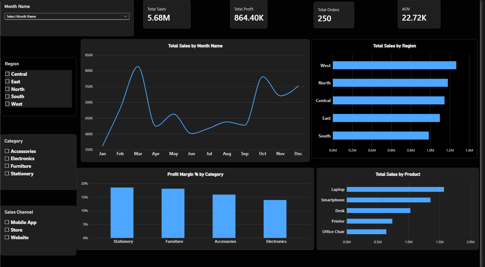
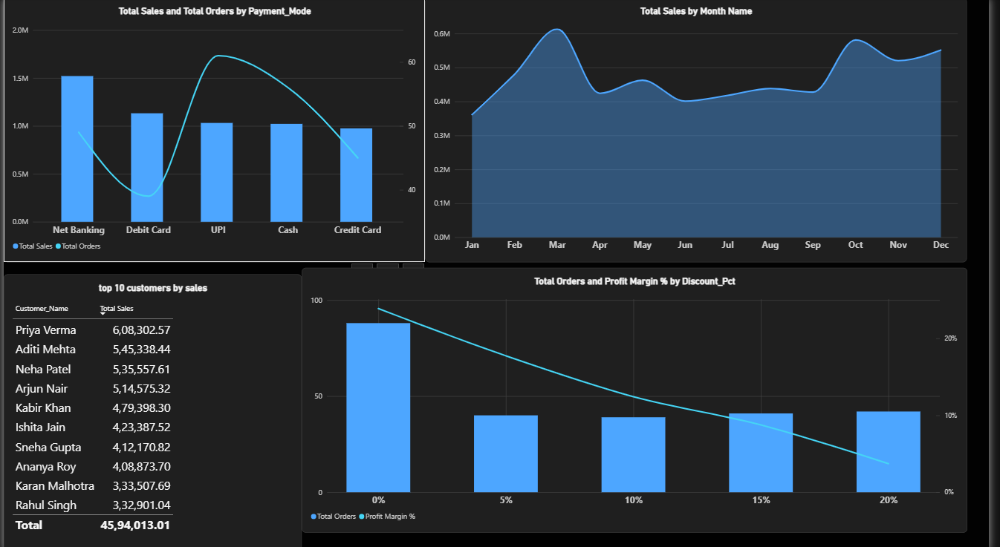

# Sales Performance Analysis (2025)

**Python (pandas) analysis and Power BI dashboard on 250 sales orders: what sells, what earns, and where discounts hurt profit.**



> **Note:** This is a practice project built on a sample dataset shared externally (not real company data). Figures describe this dataset only.

---

## 1. Project Overview

A retail business sells Electronics, Furniture, Accessories and Stationery across five Indian regions and three sales channels. The goal was to answer 15 business questions, build an interactive dashboard, and turn the numbers into insights and recommendations.

| | |
|---|---|
| **Dataset** | 250 orders, 15 columns, 2 Jan 2025 to 31 Dec 2025 |
| **Analysis** | Python 3, pandas, openpyxl (Jupyter notebook in VS Code) |
| **Dashboard** | Power BI Desktop (DAX measures, date table, slicers) |
| **Deliverables** | Notebook, answer sheet, dashboard, written insights report |

---

## 2. Headline Results

| Metric | Value |
|---|---|
| Total sales | ₹5.68M |
| Total profit | ₹864.40K (15.22% margin) |
| Total orders | 250 |
| Average order value | ₹22.72K |
| Best month | March 2025 (₹613,360.78) |
| Top product | Laptop (₹1.57M) |
| Top region | West (₹1.27M) |
| Top channel | Mobile App (₹2.18M, also highest AOV and margin) |

---

## 3. Key Insights

1. **Product concentration:** the top 5 products (Laptop, Smartphone, Desk, Printer, Office Chair) generate **93.9%** of sales.
2. **Electronics dominates but earns least:** 67.5% of sales at a **13.9%** margin, the lowest of the four categories. Stationery has the highest margin (18.5%) but only 0.2% of sales.
3. **Discounts erode profit:** orders with a discount of 15% or more earn **6.4%** margin versus **19.5%** below 15%. Margin falls steadily from 23.9% at no discount to 3.7% at a 20% discount.
4. **Loss-making orders:** 26 orders (10.4%) lost a combined ₹24,026. 23 of the 26 had discounts of 15% or more, and 16 had a 20% discount.
5. **Laptop is the top seller with the lowest margin** of any product (10.6%).
6. **Regions:** West leads (₹1.27M) and South trails (₹0.99M), a 28.6% gap.
7. **Channels:** Mobile App leads on sales, AOV (₹26.25K) and margin (16.08%). Store has the lowest margin (13.97%) and Website the lowest sales (₹1.55M).
8. **Seasonality:** sales peaked in March and were lowest in January. The largest month-over-month rise was +35.92% (October) and the largest fall was −30.85% (April). The second half of the year was 7.1% higher than the first.
9. **Customers:** the top 10 of only 15 customers account for 80.9% of sales, so this reflects a small customer base.
10. **Payment modes:** UPI has the most orders (61) but Net Banking has the highest sales (₹1.52M), so order count and order value do not rank the same way.

---

## 4. Recommendations

1. **Review discount policy.** Heavy discounts coincide with thin margins and most losses. Consider capping discounts at 10% or requiring approval above it. *Track:* margin on discounted orders and the number of loss-making orders.
2. **Rebalance the product and category mix.** Electronics drives most revenue at the lowest margin, and Laptop is the weakest-margin top seller. Promote higher-margin products (for example Desk, 18.3%) and review Laptop pricing and discounts. *Track:* category margin and the share of sales from high-margin products.
3. **Improve the Website channel.** It trails Mobile App on sales (₹1.55M vs ₹2.18M) and AOV (₹20.6K vs ₹26.3K). Consider bundles or minimum-order offers. *Track:* Website sales and AOV by channel.

Full wording is in `Sales_analysis_outcomes_filled.docx`.

---

## 5. Dashboard

Two pages in `sales_dashboard.pbix`:

- **Page 1, Overview:** KPI cards (Sales, Profit, Orders, AOV), monthly sales trend, sales by region, profit margin by category, top products. Slicers: Month, Region, Category, Sales Channel.
- **Page 2, Deep dive:** payment modes (sales and orders), monthly trend, top 10 customers, and orders with profit margin by discount level.



---

## 6. Method

1. **Validated the data first:** no missing values, no duplicate `Order_ID`, one calendar year of dates, clean categorical values, and `Profit = Sales − Cost` holds on every row. Discounts are stored as decimals (0.15 = 15%).
2. **Answered 12 analysis tasks in pandas** using filter, group and aggregate patterns.
3. **Calculated margins correctly:** total profit divided by total sales per group, never an average of per-row margins.
4. **Built the Power BI model:** DAX measures (Total Sales, Total Profit, Total Orders, AOV, Profit Margin %), a date table sorted by month number, and four slicers.
5. **Cross-checked** dashboard numbers against the Python results.
6. **Wrote insights** as finding, evidence and "so what", with each recommendation tied back to specific insights.

---

## 7. Task Coverage

| Task | Topic | Where |
|---|---|---|
| 1-12 | Totals, top products and customers, monthly and regional sales, AOV, margins, payment modes, channels, discounts, quantity, month-over-month growth | Notebook, answers in the workbook's answer sheet |
| 13-14 | Dashboard with KPIs and slicers | `dashboard.pbix` |
| 15 | 10 insights and 3 recommendations | `Sales_analysis_outcomes_filled.docx` |

---

## 8. Repository Structure

```
sales-analysis/
├── README.md
├── data_analyst_sales_practice_dataset.xlsx   # data + answer sheet
├── sales_analysis.ipynb                       # all analysis (Tasks 1-12)
├── Sales_analysis_outcomes_filled.docx        # insights and recommendations
├── sales_dashboard.pbix                             # Power BI dashboard (Tasks 13-14)
├── dashboard_page1.png
├── dashboard_page2.png
├── requirements.txt
└── .gitignore
```

## 9. How to Run

```bash
python -m venv .venv
.venv\Scripts\activate            # Windows
# source .venv/bin/activate       # Mac/Linux
pip install -r requirements.txt
```

Open `sales_analysis.ipynb` in VS Code or Jupyter, select the `.venv` kernel and choose **Run All**. Open `sales_dashboard.pbix` with Power BI Desktop (Windows).

---

## 10. Skills Demonstrated

- Data validation and cleaning checks before analysis
- pandas: `groupby`, `agg`, `pct_change`, date handling
- Business metrics: margin %, AOV, month-over-month growth, concentration
- Power BI: DAX measures, date table, interactive slicers, dashboard layout
- Communicating results: insights with evidence and actionable recommendations

## 11. Limitations

- One year of data, so seasonal patterns are tentative.
- Only 250 orders and 15 customers, so results may not hold at larger scale.
- The data shows what happened, not why. Discount findings show association, not proven cause.


---

**Author:** Tanvi | [linkedin](https://www.linkedin.com/in/tanvibhardwaj-data/) |[github](https://github.com/Tanvibhardwaj-006)
